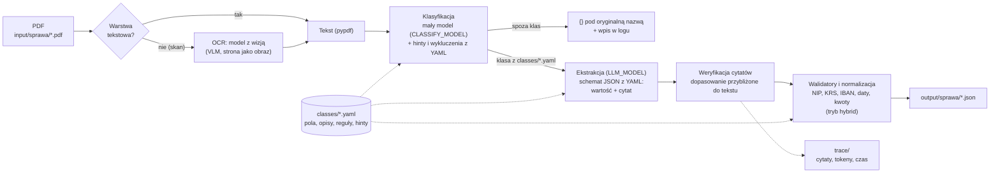
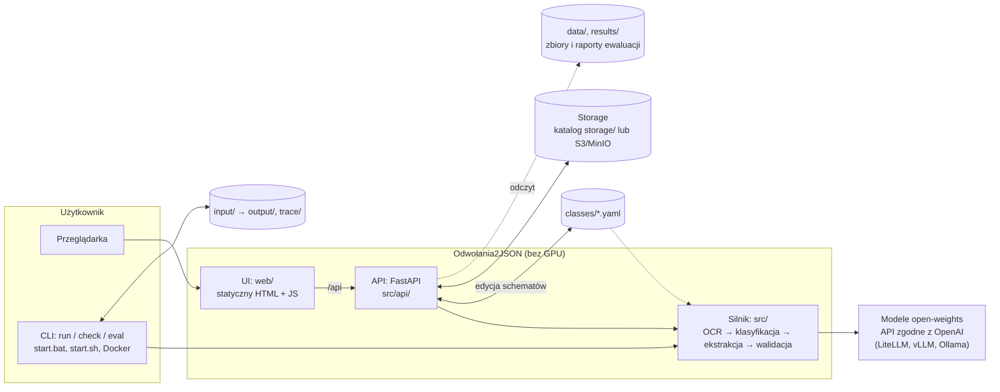

# Odwołania2JSON

Urzędnik UZP dostaje sprawę odwoławczą KIO jako kilka PDF-ów o różnym układzie, czasem skanów, i ręcznie przepisuje z nich strony, sygnatury, zarzuty i kwoty. Odwołania2JSON rozpoznaje typ każdego dokumentu (odwołanie, pełnomocnictwo, potwierdzenie przelewu) i zapisuje jego dane jako JSON zgodny ze schematem UZP, z cytatem źródłowym dla każdego pola. Nowy typ dokumentu dodaje się samym plikiem YAML, bez zmian w kodzie.

| Wynik (tryb `hybrid`, `ministral-3b` + `ministral-8b`) | |
|---|---|
| F1 na 180 PDF z referencją (60 spraw organizatora) | **0,984**, klasyfikacja 100% |
| F1 na 30 skanach (PDF bez warstwy tekstowej) | **0,922** |
| Dokumenty spoza klas odrzucone (`{}`) | **12/12** |
| Czas dla 150 PDF (limit organizatora 45 min) | **ok. 3 min** tekst, ok. 11 min same skany (`--workers 8`) |

Szczegóły pomiarów: [`docs/benchmark.md`](docs/benchmark.md).

## Uruchomienie

**1. Klucz API.** Skopiuj `.env.example` do `.env` i wklej klucz przekazany w zgłoszeniu HackTribe w `OPENAI_API_KEY=`. Adres API i modele są już ustawione.

```bash
cp .env.example .env          # Windows: copy .env.example .env
```

**2. Dokumenty.** Włóż PDF-y do `input/<sprawa>/`. Wyniki pojawią się w `output/<sprawa>/<ta-sama-nazwa>.json`. Przykładowa sprawa do próby (skan odwołania i dokument spoza klas):

```bash
cp -r data/szablon-aplikacja/input/* input/     # Windows: xcopy /E data\szablon-aplikacja\input input\
```

**3. Uruchom.** Wybierz jeden wiersz:

| Masz | Przetwarzanie `input/` → `output/` | Sprawdzenie konfiguracji | Interfejs w przeglądarce |
|---|---|---|---|
| Docker | `docker compose run --rm app` | `docker compose run --rm app check` | `docker compose up --build` → <http://localhost:8080> |
| Windows, Python 3.13+ | `start.bat` | `start.bat check` | `gui.bat` → <http://127.0.0.1:8080> |
| Linux/macOS, Python 3.13+ | `./start.sh` | `./start.sh check` | `./start.sh gui` → <http://127.0.0.1:8080> |

Skrypty `start.*` przy pierwszym uruchomieniu tworzą `.venv` i instalują `requirements.txt` (około minuty). GPU nie jest potrzebne: modele są wołane przez API.

Po przebiegu `run` wypisuje liczbę zapisanych plików, odrzuconych (`{}`) i błędów oraz czas. Szczegóły per plik: `trace/_summary.json`, cytaty źródłowe: `trace/`.

W interfejsie przeciągnij PDF-y albo kliknij „Załaduj dokument demo” (działa bez wywołania modelu). Obok podglądu PDF są pola z cytatami, a źródło każdego pola jest podświetlone w dokumencie; przełącznik „Pola / JSON” nad panelem pokazuje wynik w formacie `output/`.

**Gdy coś nie działa:** najpierw `check`. Wypisuje, czego brakuje (plik `.env`, klucz, odpowiedź każdego modelu) i co z tym zrobić.

- `BŁĄD .env` / `OPENAI_API_KEY pusty`: wróć do kroku 1.
- `Brak Pythona 3.13+`: zainstaluj z <https://www.python.org/downloads/> albo użyj Dockera.
- Port 8080 zajęty: `WEB_PORT=8081 docker compose up` albo `./start.sh gui --port 8081`.

## Jak to działa

### Przetwarzanie dokumentu



- **Klasy to konfiguracja.** Silnik w `src/` nie zna nazw klas. Pola, opisy dla modelu, reguły i słowa kontrolne są w `classes/*.yaml`.
- **Nie zgadujemy.** Cytat spoza tekstu dokumentu albo wartość o złym formacie powoduje jedną ponowną próbę, a potem `null`.
- **Limit czasu.** Dokument, który przekroczy `DOC_TIMEOUT_S` (240 s), dostaje `{}` i wpis w logu, a reszta przebiegu idzie dalej.
- **Dwa tryby** (`EXTRACTION_MODE` lub `--mode`): `hybrid` (domyślny) to model, walidatory formatów i normalizacja; `llm_only` to sam model ze schematem i weryfikacją cytatów, do porównania F1.

### Aplikacja



- **UI** ma cztery widoki: *Dokumenty* (wgranie, kolejka, eksport JSON/JSONL/CSV), *Przegląd* (PDF z podświetlonymi cytatami obok pól, status AI / Poprawione / Zatwierdzone), *Schematy* (edycja klasy formularzem albo w YAML, działa od następnego dokumentu bez restartu) i *Ewaluacja* (F1 per pole i różnice per dokument).
- **Docker** (`docker compose up`) to dwa kontenery: `web` (nginx, przekazuje `/api/` do API) i `api`. **Bez Dockera** (`gui`) jeden proces FastAPI serwuje API i pliki z `web/`. Kontrakt endpointów: [`docs/api.md`](docs/api.md).
- **Storage.** Bez `S3_BUCKET` wgrane PDF-y, wyniki i korekty trafiają do katalogu `storage/` (w Dockerze do wolumenu). Podłączenie S3/MinIO to tylko zmienne `S3_*` w `.env`.

## Model i dane

- Klasyfikacja: `mistralai/ministral-3b-2512` (3B). Ekstrakcja i OCR skanów: `mistralai/ministral-8b-2512` (8B, z wizją). Oba to modele open-weights, wołane przez LiteLLM zespołu. Kod nie zależy od dostawcy: zmiana modelu lub endpointu to zmiana `.env`.
- Wymagania organizatora (FAQ): model da się zainstalować lokalnie, API jest hostowane w UE, klucz dostarcza zespół.
- Dane: przykłady organizatora (`data/dane/`: 60 syntetycznych spraw, skany i dokumenty spoza klas). Wyniki na nich: [`docs/benchmark.md`](docs/benchmark.md).

## Jak dodać klasę dokumentu

Bez zmian w Pythonie. Gotowy przykład: `classes_examples/faktura.yaml`.

1. Skopiuj plik do `classes/` (nazwa pliku = `name` w środku): `cp classes_examples/faktura.yaml classes/`. To samo można zrobić w UI: *Schematy* → „+ Nowy typ”.
2. Opisz klasę:
   - `description`: po tym model rozpoznaje klasę; warto dopisać, czym klasa nie jest.
   - `hints`: słowa kontrolne, opcjonalnie. Dopasowanie ignoruje polskie znaki i wielkość liter, a rozstrzelone tytuły („P E Ł N O”) są sklejane.
   - `exclude_hints`: słowa wykluczające; gdy któreś stoi na początku dokumentu, to nie ta klasa (np. „orzeka:” w wyroku KIO).
   - `hint_veto`: `always` (domyślnie, brak hintu unieważnia wybór modelu), `other_class` (tylko gdy pasują hinty innej klasy) albo `never`.
   - `rules`: reguły w języku naturalnym.
   - `examples`: few-shot, opcjonalnie.
   - `requires`: opcjonalna kontrola spójności w trybie hybrid (`when: Sekcja.pole`, `then: [Sekcja.inne_pole]`); gdy `when` ma wartość, a pole z `then` jest puste, ekstrakcja jest raz ponawiana.
3. Opisz pola w `fields`:
   - Typy: `text`, `number`, `integer`, `flag` (1/0), `enum` (z `options`), `object`, `array`.
   - Pole może mieć `validator` (`nip`, `krs`, `regon`, `bzp`, `ted`, `iban`, `date`, `amount`, `email`, `pesel`), `description` dla modelu i `nullable`.
   - Dla `array` podaj `key` (pola identyfikujące element, używane przez `eval`).
   - Pole wyliczane ze słownika: `derive: {from: pole, map: {...}}`.
4. Sprawdź: `python -m src classes`. Od tej chwili klasyfikator widzi nową klasę, a `run` zapisuje jej JSON.

Nowy walidator formatu to jeden wpis w `src/validators.py` (`REGISTRY`).

## Dla deweloperów

Środowisko przez [uv](https://docs.astral.sh/uv/): `uv sync --extra api`. Skróty: `make help`.

| Cel | Komenda |
|---|---|
| Przetwarzanie, diagnostyka, UI | `make run`, `make check`, `make gui` |
| UI w Dockerze / CLI w Dockerze | `make up`, `make docker-run` |
| Testy, lint, format | `make test`, `make test-web`, `make lint`, `make format` |
| Ewaluacja F1 | `make eval` (`MODE`, `MODEL`, `LIMIT`, `EXAMPLES`, `CACHE`) |
| Seria wariantów | `make sweep CONFIG=sweeps/przyklad.yaml` |
| `requirements.txt` (wymóg dostawy) | `make requirements` |

### Opcje `run`

| Opcja | Znaczenie |
|---|---|
| `--input`, `--output`, `--trace` | katalogi (domyślnie `input`, `output`, `trace`) |
| `--classes` | katalog z klasami YAML (domyślnie `CLASSES_DIR`) |
| `--mode hybrid\|llm_only` | tryb ekstrakcji (nadpisuje `EXTRACTION_MODE`) |
| `--workers N` | równoległość (domyślnie 4; pomiary czasu: 8) |
| `--doc-timeout S` | limit czasu na dokument (nadpisuje `DOC_TIMEOUT_S`; 0 = bez limitu) |
| `--cache DIR` | cache odpowiedzi LLM na dysku (domyślnie wyłączony) |

Kod wyjścia to 1, gdy któryś dokument zakończył się błędem (np. model niedostępny). Dokument spoza klas nie jest błędem.

### Zmienne środowiskowe

Wzór z wartościami: `.env.example`. Ten sam plik czytają skrypty `start.*`, `python -m src` i `docker compose`.

| Zmienna | Domyślnie | Znaczenie |
|---|---|---|
| `OPENAI_API_KEY`, `OPENAI_BASE_URL` | | klucz i adres API zgodnego z OpenAI |
| `LLM_MODEL` | | model ekstrakcji (i domyślny dla wszystkich zadań) |
| `CLASSIFY_MODEL`, `EXTRACT_MODEL` | `LLM_MODEL` | osobny model do klasyfikacji / ekstrakcji |
| `OCR_BACKEND` | `vlm` | `vlm` albo `tesseract` |
| `VLM_MODEL` | | model z wizją do skanów |
| `VLM_BASE_URL`, `VLM_API_KEY` | `OPENAI_*` | inny endpoint dla VLM |
| `EXTRACTION_MODE` | `hybrid` | `hybrid` albo `llm_only` |
| `DOC_TIMEOUT_S` | `240` | limit czasu na dokument w sekundach |
| `CITATION_THRESHOLD` | `85` | próg dopasowania cytatu (0–100) |
| `CLASSES_DIR` | `classes` | katalog klas |
| `LLM_CONFIG` | `config/llm.json` | parametry wywołań (`max_tokens`, `temperature`, `extra_body`) |
| `S3_BUCKET`, `S3_ENDPOINT_URL`, `S3_REGION`, `S3_ACCESS_KEY`, `S3_SECRET_KEY`, `S3_CREATE_BUCKET` | | object storage dla UI; bez `S3_BUCKET` katalog `storage/` |
| `MAX_UPLOAD_MB` | `25` | limit rozmiaru pliku w UI |
| `WEB_PORT` | `8080` | port UI w `docker compose up` |

W kontenerze `localhost` to kontener, nie Twój komputer: dla LiteLLM na hoście ustaw `OPENAI_BASE_URL=http://host.docker.internal:4000/v1`.

### OCR skanów

PDF bez warstwy tekstowej jest czytany przez model z wizją: każda strona idzie jako obraz, a model zwraca przepisany tekst. Gdy VLM zawiedzie, a Tesseract jest zainstalowany, program użyje go zapasowo.

Tesseract jest opcjonalny i nie wchodzi do `requirements.txt` ani do obrazu Docker. Instalacja: program z językiem polskim (macOS `brew install tesseract tesseract-lang`, Debian/Ubuntu `sudo apt install tesseract-ocr tesseract-ocr-pol`, Windows: instalator z <https://github.com/UB-Mannheim/tesseract/wiki>), potem `pip install pytesseract` i `OCR_BACKEND=tesseract`.

### Ewaluacja

F1 per pole na przykładach z referencją (`data/dane/przyklad_NN/`):

```bash
uv run python -m src eval --mode hybrid
uv run python -m src eval --limit 10                 # szybki test
uv run python -m src eval --examples 01,02,13        # wybrane przykłady
uv run python -m src eval --dump results/dump        # predykcja, referencja i różnice per dokument
uv run python -m src sweep sweeps/przyklad.yaml      # porównanie modeli i ustawień
```

Raport pokazuje precision, recall i F1 per pole i łącznie, exact match dokumentu, poprawność klasyfikacji, odsetek zweryfikowanych cytatów, negatywy (ile PDF-ów spoza klas dostało `{}`) i czas z prognozą dla 150 PDF. Skaner organizatora nie jest opublikowany; nasze założenia porównania opisuje dokument projektowy (sekcja 7). Sweep zapisuje każdy wariant do `<out_dir>/<name>/`, a zestawienie do `summary.md`; wariant z błędem nie przerywa serii.

UI czyta dane do ewaluacji wg `config/eval-datasets.yaml` (najpierw object storage, potem katalog lokalny) i pokazuje raporty z `results/`. Wgranie zbiorów do bucketa: `uv run --extra api python -m scripts.upload_datasets`.

### Wdrożenie (Coolify)

Resource → Docker Compose → to repo, plik `docker-compose.yml`. Zmienne ustawia się w UI Coolify, domenę przypisuje się usłudze `web` (port 80). Proxy i TLS zapewnia Coolify, a `docker-compose.override.yml` (port 8080) działa tylko lokalnie.

## Struktura

```
src/               silnik (generyczny, nie zna nazw klas) i CLI: python -m src
src/api/           API (FastAPI): dokumenty, schematy, ewaluacja, storage
web/               UI (statyczny HTML + JS; w Dockerze nginx)
classes/           klasy dokumentów (YAML)
classes_examples/  przykład klasy do skopiowania (faktura)
config/            parametry LLM, rozmiary modeli, zbiory ewaluacji
sweeps/            konfiguracje serii ewaluacji
data/              przykłady organizatora, szablon input/output, dokument demo
results/           zapisane raporty ewaluacji (czytane przez UI)
docs/              dokument projektowy, schematy UZP, benchmark, API
input/, output/    wejście i wyjście run (puste w repo)
start.bat, start.sh, gui.bat   uruchomienie bez Dockera
```

## Co powstało podczas HackNation

Całe repozytorium powstało w trakcie HackNation (pierwszy commit 21.11.2026, 10:46): silnik ekstrakcji, klasy YAML, walidatory, OCR przez VLM, ewaluacja i sweep, API, UI oraz Docker. Dane wejściowe pochodzą od organizatora.

## Licencje

- Zależności: pypdf (BSD), pydantic (MIT), PyYAML (MIT), openai SDK (Apache-2.0), RapidFuzz (MIT), pypdfium2 (Apache-2.0/BSD), Pillow (HPND), python-dotenv (BSD), FastAPI (MIT), uvicorn (BSD), python-multipart (Apache-2.0), boto3 (Apache-2.0).
- Opcjonalnie: pytesseract (Apache-2.0), Tesseract (Apache-2.0).
- Front i Docker: nginx (BSD-2-Clause), fonty Source Sans 3 i Source Serif 4 (SIL OFL 1.1, `web/css/fonts/LICENSE.txt`).
- Modele: licencje według kart modeli Mistral AI (`docs/benchmark.md`).
