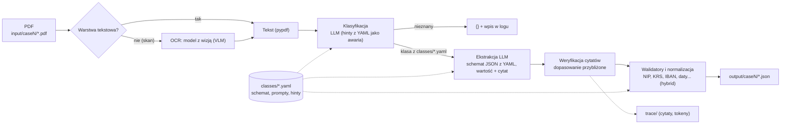

# Odwołania2JSON

Zamienia PDF-y sprawy odwoławczej KIO na JSON-y zgodne ze schematem UZP (HackNation 2026, zadanie UZP).

```
input/case1/*.pdf  →  klasyfikacja  →  ekstrakcja modelem  →  walidacja  →  output/case1/<ta-sama-nazwa>.json
```

- Klasy dokumentów: `odwolanie`, `pelnomocnictwo`, `przelew`. Dokument spoza klas (`nieznany`) dostaje pusty JSON `{}` pod oryginalną nazwą pliku oraz wpis w logu.
- Każda klasa to plik YAML w `classes/`. **Nowa klasa nie wymaga zmian w kodzie** (patrz niżej).
- Dla każdego pola model podaje cytat z dokumentu, a kod sprawdza go w tekście. Ślad cytatów trafia do `trace/` (nie do `output/`).
- Tylko open source, w tym modele open-weights. Model jest wołany przez API zgodne z OpenAI (LiteLLM, vLLM, Ollama). Kod nie wymaga GPU. Wymagania organizatora (FAQ): model da się zainstalować lokalnie, a API jest hostowane w UE przez dostawcę z polityką prywatności; klucz API do używanej usługi dostarcza zespół.
- Imiona i nazwiska są zwracane w mianowniku („Mateusz Szymański”), brak informacji to `null`.

## Architektura



- Klasy opisuje wyłącznie konfiguracja YAML (schemat pól, opis, hinty, reguły), dlatego nowa klasa nie wymaga zmian w kodzie.
- Cytaty są weryfikowane w kodzie (cytat spoza tekstu wywołuje ponowną próbę, wynik trafia do `trace/`). Wartość o błędnym formacie po ponownej próbie dostaje `null`; program nie zgaduje.
- Model (ekstrakcja) i VLM (OCR) są wołane przez API zgodne z OpenAI (LiteLLM, vLLM, Ollama), więc maszyna docelowa nie potrzebuje GPU.

## Uruchomienie

Trzy sposoby, każdy wymaga pliku `.env` (klucz i adres API) oraz PDF-ów w `input/caseN/`; wynik trafia do `output/caseN/`.

| Sposób | Komenda | Wymagania |
|---|---|---|
| pip (Linux/macOS) | `pip install -r requirements.txt && python -m src run` w venv | Python 3.13+ |
| Windows | `start.bat` (venv, pip i `run` w jednym kroku) | Python 3.13+ |
| Docker | `docker compose run --rm app` | Docker |
| UI + API | `docker compose up --build`, potem http://localhost:8080 | Docker |

Lokalne API i interfejs graficzny: sekcja „UI i API”.

Szczegóły poniżej. Wymagania: Python 3.13+. Instalacja przez `pip` (`requirements.txt`) albo [uv](https://docs.astral.sh/uv/) (`uv.lock`). Do skanów potrzebny jest model z wizją (VLM, patrz „OCR skanów”); Tesseract jest opcjonalny i nie instaluje się domyślnie.

```bash
cp .env.example .env        # uzupełnij OPENAI_API_KEY, OPENAI_BASE_URL, LLM_MODEL (+ VLM_MODEL dla skanów)
mkdir -p input/case1 && cp "twoj plik.pdf" input/case1/

# pip (Linux/macOS)
python3.13 -m venv .venv && source .venv/bin/activate
pip install -r requirements.txt
python -m src run

# uv
uv sync && uv run python -m src run
```

Windows: `start.bat` sam tworzy `.venv`, instaluje `requirements.txt` i uruchamia `run` (argumenty są przekazywane, np. `start.bat classes`). Docker:

```bash
cp .env.example .env
docker compose build
docker compose run --rm app            # = run na input/ → output/
docker compose run --rm app classes    # lista wczytanych klas
```

W kontenerze `localhost` to nie Twój komputer. Jeśli LiteLLM działa na hoście, ustaw `OPENAI_BASE_URL=http://host.docker.internal:4000/v1`.

### OCR skanów

PDF bez warstwy tekstowej jest czytany przez model z wizją (VLM): każda strona idzie jako obraz do API zgodnego z OpenAI, a model zwraca przepisany tekst. Ustawienia w `.env`:

| Zmienna | Znaczenie |
|---|---|
| `OCR_BACKEND` | `vlm` (domyślnie) lub `tesseract` |
| `VLM_MODEL` | nazwa modelu z wizją (open-weights); wymagana dla `vlm` |
| `VLM_BASE_URL`, `VLM_API_KEY` | opcjonalnie inny endpoint i klucz niż `OPENAI_*` |

Model ekstrakcji (`LLM_MODEL`) może być tekstowy. Gdy VLM zawiedzie, a Tesseract jest zainstalowany, program użyje go jako zapasowego.

**Tesseract (opcjonalnie, tylko jeśli nie masz VLM).** Nie jest częścią `requirements.txt`. Zainstaluj program z danymi języka polskiego, potem pakiet Pythona:

- macOS: `brew install tesseract tesseract-lang`
- Debian/Ubuntu: `sudo apt install tesseract-ocr tesseract-ocr-pol`
- Windows: instalator z <https://github.com/UB-Mannheim/tesseract/wiki> (zaznacz język Polish), dodaj do `PATH`
- pakiet: `pip install pytesseract` (lub `uv sync --extra tesseract`), potem `OCR_BACKEND=tesseract`

Obraz Docker nie zawiera Tesseracta (używa VLM).

### Makefile

Skróty do najczęstszych komend: `make help` (lista), `make install`, `make test`, `make run`, `make classes`, `make eval MODE=llm_only LIMIT=10 MODEL=<nazwa>`, `make eval-hybrid`, `make eval-llm-only`, `make docker-build`, `make docker-run`, `make clean`.

### Opcje `run`

| Opcja | Znaczenie |
|---|---|
| `--input`, `--output`, `--trace` | katalogi (domyślnie `input`, `output`, `trace`) |
| `--classes` | katalog z klasami YAML (domyślnie `CLASSES_DIR`, czyli `classes`) |
| `--mode hybrid\|llm_only` | tryb ekstrakcji (nadpisuje `EXTRACTION_MODE`) |
| `--workers N` | równoległość (domyślnie 4) |

Kod wyjścia to 1, gdy jakiś dokument zakończył się błędem (np. model niedostępny, brak tekstu w PDF). Dokument `nieznany` nie jest błędem.

### Zmienne środowiskowe

| Zmienna | Domyślnie | Znaczenie |
|---|---|---|
| `OPENAI_API_KEY`, `OPENAI_BASE_URL`, `LLM_MODEL` | | endpoint i model |
| `EXTRACTION_MODE` | `hybrid` | `hybrid` = model + walidatory/normalizacja; `llm_only` = sam model |
| `CLASSES_DIR` | `classes` | katalog klas |
| `CITATION_THRESHOLD` | `85` | próg dopasowania cytatu (0–100) |

## Tryby ekstrakcji

- `hybrid` (domyślny): po odpowiedzi modelu działają walidatory formatów (NIP, KRS, REGON, BZP, TED, IBAN, daty ISO, kwota). Błędny format = jedna ponowna próba, potem `null`.
- `llm_only`: bez walidatorów i normalizacji; wynik to wartości zwrócone przez model. Schemat, weryfikacja cytatów i reguły w języku naturalnym działają nadal.

## Ewaluacja

Lokalny F1 na przykładach z referencją (`data/dane/przyklad_NN/`):

```bash
uv run python -m src eval --mode hybrid
uv run python -m src eval --mode llm_only --model <nazwa> --out-json wyniki.json
uv run python -m src eval --limit 10        # szybki test
uv run python -m src eval --dump results/dump   # predykcja, referencja i różnice per dokument
uv run python -m src eval --examples 01,02,13   # tylko wybrane przykłady (make eval EXAMPLES=01,02,13)
uv run python -m src eval --cache results/cache  # cache odpowiedzi LLM na dysku (domyślnie wyłączony; też w run)
```

Raport pokazuje precision, recall i F1 per pole oraz łącznie, exact match dokumentu, poprawność klasyfikacji, odsetek poprawnych cytatów i odsetek `null` przy polach z wartością referencyjną. Skaner organizatora nie jest opublikowany, więc założenia porównania są w dokumencie projektowym (sekcja 7). `--dump` zapisuje dla każdego PDF-a predykcję, referencję, listę różnic i ślad cytatów (`<dump>/<przyklad>/<plik>.json`; `_missed.json` dla klas bez dokumentu). `run` zapisuje dodatkowo `trace/_summary.json` (klasa, błąd, plik wyjściowy, tokeny per plik). Wyniki pomiarów: `docs/benchmark.md`.

### Seria ewaluacji na wielu wariantach

Porównanie modeli i ustawień jednym poleceniem (ten sam klucz API z `.env`, wariant zmienia model, tryb, OCR):

```bash
uv run python -m src sweep sweeps/przyklad.yaml    # lub: make sweep CONFIG=sweeps/przyklad.yaml
```

Plik YAML (wzór: `sweeps/przyklad.yaml`) ma `out_dir`, wspólne ustawienia (`data`, `workers`, `cache`, `mode`, `limit`, `examples`, `ocr_backend`, `vlm_model`, `llm_config`) i listę `variants` (`name`, `model` oraz opcjonalne nadpisania). Pełne wyniki każdego wariantu trafiają do `<out_dir>/<name>/` (`report.json`, `report.txt`, `dump/`), a zestawienie do `<out_dir>/summary.md` i `summary.json`. Wariant z błędem (np. brak dostępu do modelu) nie przerywa serii.

## Jak dodać klasę dokumentu

Nic nie edytujesz w Pythonie. Przykład: `classes_examples/faktura.yaml`.

1. Skopiuj plik do `classes/` (nazwa pliku = `name` w środku): `cp classes_examples/faktura.yaml classes/`.
2. Opisz klasę: `description` (model rozpoznaje po nim klasę), `hints` (słowa kontrolne, opcjonalnie; dopasowanie bez polskich znaków i wielkości liter, rozstrzelone tytuły typu „P E Ł N O” są sklejane), `hint_veto` (`always` domyślnie: brak hintu unieważnia wybór modelu; `other_class`: tylko gdy pasują hinty innej klasy; `never`), `rules` (reguły w języku naturalnym), `examples` (few-shot, opcjonalnie), `requires` (opcjonalna kontrola spójności w trybie hybrid: `when: Sekcja.pole`, `then: [Sekcja.inne_pole]`; gdy `when` ma wartość, a pole z `then` jest puste, ekstrakcja jest raz ponawiana z tą uwagą).
3. Opisz pola w `fields`. Typy: `text`, `number`, `integer`, `flag` (1/0), `enum` (z `options`), `object`, `array`. Pole może mieć `validator` (`nip`, `krs`, `regon`, `bzp`, `ted`, `iban`, `date`, `amount`, `email`, `pesel`), `description` dla modelu, `nullable`. Dla `array` podaj `key` (pola identyfikujące element, używane przez `eval`). Pole wyliczane ze słownika: `derive: {from: pole, map: {...}}`.
4. Sprawdź: `uv run python -m src classes`. Od tej chwili klasyfikator widzi nową klasę, a `run` zapisuje jej JSON.

Nowy walidator formatu to jeden wpis w `src/validators.py` (`REGISTRY`).

## UI i API

```bash
cp .env.example .env
docker compose up --build        # UI: http://localhost:8080, API: kontener `api` (port 8000 wewnątrz sieci)
```

Front (`web/`, statyczny HTML + JS, nginx) i API (`src/api/`, FastAPI) to osobne kontenery; nginx przekazuje `/api/` do API. Kontrakt endpointów: [`docs/api.md`](docs/api.md). Bez Dockera: `uv sync --extra api && uv run python -m src serve` (API na `127.0.0.1:8000`; front `web/` serwuj dowolnym serwerem statycznym z proxy `/api`).

- **Dokumenty użytkowników** (wgrane w UI PDF-y, wyniki ekstrakcji, korekty) trafiają do object storage: S3 albo MinIO (`S3_BUCKET`, `S3_ENDPOINT_URL`, `S3_ACCESS_KEY`, `S3_SECRET_KEY`, patrz `.env.example`). Bez `S3_BUCKET` aplikacja zapisuje do katalogu `./storage`, więc działa od razu, a podłączenie bucketa to tylko zmiana `.env`.
- **Ewaluacja.** Dane do ewaluacji (`config/eval-datasets.yaml`) są czytane z object storage pod `prefix` (np. `datasets/dane`), a gdy tam pusto, z katalogu lokalnego (`path`). Wgranie zbiorów do bucketa: `uv run --extra api python -m scripts.upload_datasets`. Domyślnie UI pokazuje wyniki odczytane z plików lokalnych (`results/`, tylko odczyt: raporty `eval --out-json` i `sweep`). Dodatkowe przebiegi uruchomione z UI zapisują raport i diffy per dokument w object storage.
- **Schematy.** Typy dokumentów to YAML w `classes/`; edycja w UI zapisuje plik (po walidacji) i działa od następnego dokumentu, bez restartu.
- **Przegląd.** Pole ma status AI / Poprawione / Zatwierdzone. Zamiast „pewności” UI pokazuje, czy cytat źródłowy został zweryfikowany w tekście. Podświetlenia cytatów w PDF są liczone dopasowaniem przybliżonym do warstwy tekstowej (skany: bez podświetleń).

## Struktura

```
src/               kod (generyczny silnik, nie zna nazw klas)
src/api/           API (FastAPI): dokumenty, schematy, ewaluacja, storage
web/               UI (statyczny front + nginx)
classes/          klasy dokumentów (YAML)
classes_examples/ przykład klasy do skopiowania
docs/             projekt, plan, schematy organizatora, benchmark
data/dane/        60 przykładów z referencją (organizator)
tests/            testy (pytest)
```

Testy: `make test` (`uv run pytest`). Lint i format: `make lint`, `make format` (ruff). Zależności deweloperskie instaluje `uv sync`. `requirements.txt` (wymóg dostawy) generuje `make requirements`.

## Licencje

Zależności: pypdf (BSD), pydantic (MIT), PyYAML (MIT), openai SDK (Apache-2.0), RapidFuzz (MIT), pypdfium2 (Apache-2.0/BSD), Pillow (HPND), python-dotenv (BSD). Opcjonalnie: pytesseract (Apache-2.0), Tesseract (Apache-2.0). Licencja wybranego modelu: patrz `docs/benchmark.md` (po wyborze).
